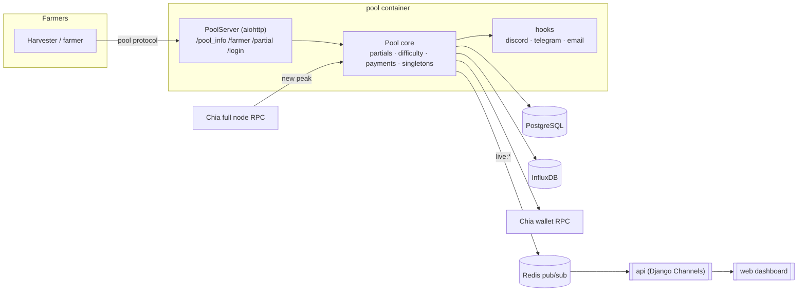

# Pool.Energy — Pool

[](https://github.com/Pool-Energy/pool/actions/workflows/build-and-publish.yml)
[](https://www.python.org)
[](https://www.chia.net)
[](LICENSE)

The pool server for **Pool.Energy**, a Chia farming pool. It implements the
official Chia **pool protocol**, validates partials, adjusts farmer difficulty,
tracks singletons on-chain, absorbs pool rewards, and pays farmers in PPLNS from
a Chia wallet — while publishing live events and timeseries for the
[api](https://github.com/Pool-Energy/api) and the
[web](https://github.com/Pool-Energy/web) dashboard.



---

## Table of contents

- [Tech stack](#tech-stack)
- [Features](#features)
- [Getting started](#getting-started)
- [Configuration](#configuration)
- [Project structure](#project-structure)
- [Architecture](#architecture)
- [Pool protocol endpoints](#pool-protocol-endpoints)
- [Hooks](#hooks)
- [Tests](#tests)
- [Docker image](#docker-image)
- [Continuous integration](#continuous-integration)
- [Troubleshooting](#troubleshooting)
- [Contributing](#contributing)
- [License](#license)

## Tech stack

| Concern        | Choice                                                                 |
| -------------- | ---------------------------------------------------------------------- |
| Language       | Python 3.11+ (`asyncio`, `typing` unions, `datetime.UTC`)              |
| Event loop     | `uvloop`                                                               |
| HTTP server    | `aiohttp` on the Chia pool protocol                                    |
| Chia           | `chia-blockchain` fork `release/2.7.5`, `chia_rs` 0.48 (BLS, proofs)   |
| Database       | PostgreSQL through `aiopg` (system of record)                          |
| Time series    | InfluxDB 2 (`influxdb-client`), buckets `chia_pool` / `chia_partial`   |
| Live events    | Redis pub/sub (`live:<kind>:<scope>`)                                  |
| Logging        | `colorlog` console + rotating JSON logs for the API                    |
| Tests          | `pytest` + `pytest-asyncio` (`asyncio_mode=auto`)                      |
| Lint           | `flake8` (`max-line-length = 120`)                                     |
| License        | AGPL-3.0                                                               |

## Features

- **Official pool protocol** (`/pool_info`, `/farmer`, `/partial`, `/login`)
  compatible with Chia harvesters and the pool reference implementation.
- **Partial validation**: signature check, puzzle hash check, difficulty check,
  duplicate and stale-partial detection, confirmation against the node before
  points are awarded.
- **PPLNS accounting** with a configurable `pplns_interval` window, cached in
  memory and backed by PostgreSQL.
- **Dynamic difficulty** per farmer (`number_of_partials_target`,
  `time_target`), with static override through `custom_difficulty = EXPERT:<n>`
  and min/max bounds.
- **Singleton tracking**: follows each launcher's singleton, detects pool
  leaving, and supports `launchers_banned` / `launchers_min_version`.
- **Automated payouts**: payment targets computed from points, fees subtracted,
  transactions signed through the wallet RPC and recorded as payouts.
- **Pool reward absorption** with configurable fee handling.
- **Live feeds and timeseries** for the API: Redis events and InfluxDB points.
- **Hooks** to notify Discord, Telegram or email on blocks, payments, partial
  gaps and size drops.

## Getting started

### Requirements

- **Python 3.11+** (the image uses Debian bookworm's 3.11)
- A **Chia full node** and **wallet** running with RPC enabled
  (`CHIA_ROOT`, usually `/data/chia/<network>`)
- **PostgreSQL**, **Redis**, **InfluxDB 2**
- Outbound network access for price data (XCH price loop)

### Install

```bash
python3 -m venv venv
./venv/bin/pip install -r requirements.txt
```

`setup.py` also exposes the package as `pool` (`pip install -e .`), pulling the
Pool.Energy `chia-blockchain` fork.

### Configure

Copy the configuration described in [Configuration](#configuration) to
`config.yaml` — the container expects it at `/data/config.yaml`. A minimal
example:

```yaml
server:
  server_host: 0.0.0.0
  server_port: 8088

pool_url: 'https://pool.energy'
login_url: 'https://pool.energy/login'
welcome_message: 'Welcome to Pool.Energy!'

pool_info:
  name: 'Pool.Energy'
  logo_url: 'https://pool.energy/assets/images/poolenergy/logo.svg'
  description: 'Chia farming pool'
  default_res: 'https://pool.energy'

wallets:
  - fingerprint: 1234567890
    pool_puzzle_hash: 'xch1…'
    payout_address: 'xch1…'

nodes:
  - host: '127.0.0.1'
    port: 8555

fee:
  pool: 0.0075
  address: 'xch1…'
```

### Run

```bash
./venv/bin/python -m pool.pool_server -c config.yaml --log-level INFO --log-dir /data/logs
```

`python -m pool` is an alias: `pool/__main__.py` simply calls the same `main()`.
Without `--log-dir`, logs only go to the console; with it, rotating
`main.log` / `partial.log` files and their `.json` variants are written as well
(the API tails the JSON ones).

### Docker

```bash
docker build -t pool-energy-pool .

docker run --rm -p 8088:8088 \
  -v "$(pwd)/config.yaml:/data/config.yaml:ro" \
  -v /srv/chia:/data/chia \
  -v /srv/logs:/data/logs \
  -e LOGLEVEL=INFO \
  pool-energy-pool
```

## Configuration

All keys below are read from the YAML file passed to `-c` (`CONFIG_FILE` in the
container).

### Server and identity

| Key                | Description                                                    |
| ------------------ | -------------------------------------------------------------- |
| `server.server_host` / `server.server_port` | Bind address of the aiohttp server (default port `8088`) |
| `pool_url`         | Public pool URL written into farmer singletons                 |
| `login_url`        | URL returned by `/login` (deep link to the farmer page)        |
| `welcome_message`  | Message returned on farmer join                                |
| `pool_info.name` / `logo_url` / `description` / `default_res` | Served by `/pool_info` |

### Blockchain and difficulty

| Key                             | Description                                              |
| ------------------------------- | -------------------------------------------------------- |
| `min_difficulty`                | Lower bound for farmer difficulty                        |
| `default_difficulty`            | Difficulty assigned to new farmers                       |
| `number_of_partials_target`     | Partial count used by the difficulty algorithm           |
| `time_target`                   | Target seconds between partials                          |
| `partial_time_limit`            | Maximum age of an accepted partial                       |
| `partial_confirmation_delay`    | Delay before confirming partials with the node           |
| `confirmation_security_threshold`| Confirmations required before crediting points           |
| `scan_start_height`             | Height used when scanning singletons at startup          |
| `relative_lock_height`          | Pool protocol relative lock height (must not change)     |
| `max_additions_per_transaction` | Wallet limit when building payout transactions           |
| `authentication_token_timeout`  | Validity window of `/farmer` authentication tokens       |
| `launchers_min_version`         | Minimum accepted harvester version                       |
| `launchers_banned`              | List of banned launcher ids                              |

### Payments

| Key                          | Description                                            |
| ---------------------------- | ------------------------------------------------------ |
| `fee.pool`                   | Pool fee applied to rewards                            |
| `fee.address`                | Fee wallet address (`txch…` switches testnet mode)     |
| `fee.mojos_per_cost`         | Conversion used for fee computation                    |
| `fee.stay_discount` / `stay_length` | Discount for long-time farmers                  |
| `fee.size_discount` / `max_discount` | Discount by farm size                        |
| `fee.payment` / `payment_absolute` | Transaction fee policy (`true`, `false`, `auto`) |
| `fee.absorb` / `absorb_mempool` / `absorb_absolute` | Reward absorption fee policy |
| `payment_interval`           | Seconds between payment attempts                       |
| `collect_pool_rewards_interval` | Seconds between reward collection cycles            |
| `min_payment`                | Minimum amount for a payout target                     |
| `pplns_interval`             | PPLNS window in seconds (default 1 day)                |
| `reward_system`              | Reward system identifier (default `PPLNS`)             |
| `absorbed_extra_coins`       | Extra coins to absorb per reward                       |

### Infrastructure

| Key                | Description                                                     |
| ------------------ | --------------------------------------------------------------- |
| `wallets[]`        | Wallet entries (`fingerprint`, `pool_puzzle_hash`, `payout_address`) |
| `nodes[]`          | Full node RPC endpoints (`host`, `port`)                        |
| `database`         | `host`, `user`, `password`, `name` — or a single `database_dsn` |
| `influxdb`         | `url`, `token`, `org`, `bucket`, `bucket_partial`               |
| `redis`            | `host`, `port` (pub/sub for live events)                        |
| `hooks`            | Map of event name → command(s), see [Hooks](#hooks)             |

## Project structure

```
pool/
├── docker/entrypoint.sh        # SMTP proxy, chia init, pool_server startup
├── hooks/                      # Notification scripts (Discord, Telegram, email)
│   ├── discord_absorb.py
│   ├── telegram_absorb.py
│   ├── payment_email.py
│   ├── size_drop_email.py
│   ├── missing_partials.py
│   └── *_template.txt
├── pool/
│   ├── __main__.py             # python -m pool
│   ├── pool_server.py          # aiohttp server, pool protocol handlers
│   ├── pool.py                 # Core orchestration (~2.4k lines)
│   ├── partials.py             # Partial cache, validation, PPLNS accounting
│   ├── payment.py              # Payout transaction building
│   ├── difficulty_adjustment.py
│   ├── launchers.py            # Singleton following / membership
│   ├── singleton.py            # On-chain singleton state helpers
│   ├── absorb_spend.py         # Reward absorption
│   ├── fee.py                  # Fee/discount computation
│   ├── notifications.py        # Size-drop and payment notifications
│   ├── record.py               # FarmerRecord streamable
│   ├── task.py                 # Common task/loop helpers
│   ├── util.py                 # Protocol helpers, effort, discounts
│   ├── xchprice.py             # XCH price loop
│   └── store/
│       ├── postgresql_store.py # System of record (aiopg)
│       ├── influxdb_store.py   # Timeseries
│       ├── redis_store.py      # Live pub/sub + snapshots
│       └── sqlite_store.py     # Not wired in Pool (legacy)
├── tests/                      # pytest suite
├── tools/                      # Operational scripts shipped in the image
├── Dockerfile
├── requirements.txt
├── setup.py
└── README.md
```

## Architecture

### Bootstrap

1. `pool_server.main()` parses `-c/--config`, `--log-level` and `--log-dir`,
   then configures logging: console for everything, `pool` → `main.log` and
   `partials` → `partial.log` (plus `.json` rotating variants used by the API).
2. `PoolServer` loads the YAML config and instantiates `Pool`.
3. `Pool.start()` connects the three stores, reloads recent partials into the
   cache, and starts the background loops.
4. `aiohttp` serves the pool protocol on `server.server_host:server_port`.

### Background loops

| Loop                             | Responsibility                                        |
| -------------------------------- | ----------------------------------------------------- |
| `get_peak_loop`                  | Polls the node for new peaks and reacts to them       |
| `confirm_partials_loop`          | Confirms pending partials and credits points          |
| `stuck_partials_watchdog_loop`   | Detects pending partials that never confirm           |
| `collect_pool_rewards_loop`      | Absorbs pool rewards into the pool wallet             |
| `create_payment_loop` (per wallet) | Computes payment targets from points                |
| `submit_payment_loop` (per wallet) | Signs and submits payouts through the wallet RPC    |
| `Partials` loops                 | Scrub old partials, recompute estimated sizes, detect missing partials |
| `Launchers.singleton_loop`       | Follows singletons and prunes farmers that left       |
| `Notifications` loop             | Detects farm-size drops and enqueues notifications    |
| `XCHPrice` loop                  | Records XCH price points into InfluxDB                |

Every loop is wrapped so an unexpected exception is logged without killing the
process (`task.py` helpers, `pool/util.py`).

### Stores

- **PostgreSQL** (`aiopg`) is the source of truth: farmers, partials, blocks,
  payouts, payout addresses, transactions, notifications.
- **InfluxDB** stores points for pool size, netspace, mempool, XCH price and
  partial throughput. Writes are retried (`WRITE_MAX_ATTEMPTS`) and failures are
  logged, never fatal.
- **Redis** is used for live events only. Publishing is best-effort: events go
  to `live:partial:all`, `live:partial:<launcher_id>`, `live:block:*`,
  `live:payout:*`, `live:pool_status`, etc., and are relayed to WebSocket
  clients by the API.

## Pool protocol endpoints

| Method | Path         | Purpose                                            |
| ------ | ------------ | -------------------------------------------------- |
| GET    | `/`          | Liveness/index response                            |
| GET    | `/pool_info` | Pool name, logo, description, fee, target address  |
| GET    | `/farmer`    | Farmer record (singleton state, difficulty, points)|
| POST   | `/farmer`    | Farmer join (validates `PostFarmerRequest`)        |
| PUT    | `/farmer`    | Farmer update (validates `PutFarmerRequest`)       |
| POST   | `/partial`   | Partial submission (`PostPartialRequest`)          |
| GET    | `/login`     | Login URL for the farmer dashboard                 |

All responses use the Chia pool protocol error codes (`PoolErrorCode`) and
CORS headers are added to error responses. Authentication tokens are validated
against `authentication_token_timeout`.

## Hooks

`pool.run_hook(name, *args)` runs every command configured under
`hooks.<name>` in the YAML (`str` or list of `str`). Each argument is
serialised to JSON and appended after the uppercase event name, so a hook is
called as:

```bash
<command...> ABSORB '<json-coin>' '<json-farmer>'
```

Hooks also receive the pool configuration path through `CONFIG_PATH`, which the
bundled scripts use for their webhook/SMTP settings.

| Event               | Arguments                        | Bundled script                 |
| ------------------- | -------------------------------- | ------------------------------ |
| `absorb`            | absorbed coins, farmer records   | `hooks/discord_absorb.py`, `hooks/telegram_absorb.py` |
| `payment`           | payments per launcher            | `hooks/payment_email.py`       |
| `size_drop`         | launcher size-drop notifications | `hooks/size_drop_email.py`     |
| `missing_partials`  | farmers without recent partials  | `hooks/missing_partials.py`    |

Hooks are fire-and-forget subprocesses: a failing hook never blocks the pool.

## Tests

```bash
./venv/bin/pytest
```

`tests/pytest.ini` sets `asyncio_mode=auto`. The suite covers the difficulty
algorithm (`test_difficulty.py`), payment fee computation (`test_payment.py`),
the PostgreSQL store (`store/test_postgresql_store.py`) and a win simulation
helper. `flake8` is configured with a 120-character limit.

## Docker image

`Dockerfile` builds a single `debian:bookworm-slim` stage:

1. Installs `python3-venv`, `python3-yaml`, `python3-aiohttp`, `python3-dev`,
   `libpq-dev`, `gcc`, `git`, `simpleproxy` and networking tools.
2. Creates `/root/pool/venv` and installs `requirements.txt`.
3. Copies `pool/`, `hooks/`, `tools/` and `docker/entrypoint.sh`.

`docker/entrypoint.sh`:

```bash
export CHIA_ROOT=/data/chia/${CHIA_NETWORK:=mainnet}
trap "killall python" TERM
simpleproxy -d -L 127.0.0.1:25 -R ${MAIL_HOSTNAME:=mail}:25
[ -e "$CHIA_ROOT/config/config.yaml" ] || ./venv/bin/chia init
exec ./venv/bin/python -m pool.pool_server \
  --log-level ${LOGLEVEL:=INFO} --log-dir ${LOGDIR:=/data/logs} \
  -c ${CONFIG_FILE:=/data/config.yaml}
```

| Variable        | Default                 | Description                          |
| --------------- | ----------------------- | ------------------------------------ |
| `CHIA_NETWORK`  | `mainnet`               | Sets `CHIA_ROOT=/data/chia/<network>`|
| `LOGLEVEL`      | `INFO`                  | Log level                            |
| `LOGDIR`        | `/data/logs`            | Rotating log directory (JSON for API)|
| `CONFIG_FILE`   | `/data/config.yaml`     | Pool configuration                   |
| `MAIL_HOSTNAME` | `mail`                  | SMTP relay target for `simpleproxy`  |

The image exposes `8088` (the protocol port) and stops through
`killall python` on `SIGTERM`.

## Continuous integration

`.github/workflows/build-and-publish.yml` runs on pushes to `main`,
`feature/*`, `bugfix/*`, `hotfix/*` and `v*.*.*` tags, and on pull requests to
those branches. It builds the image for `linux/amd64` with `no-cache: true` and
pushes it to `ghcr.io/pool-energy/pool` (except on pull requests), tagged with
the commit SHA, branch, semver and `latest`. The workflow builds the image;
tests are not executed in CI.

## Troubleshooting

| Symptom                                          | Fix                                                                 |
| ------------------------------------------------ | ------------------------------------------------------------------- |
| `PoolErrorCode` / fee mismatch in the web UI     | `POOL_CONFIG_PATH` on the API must point to the same `config.yaml`   |
| Farmers stuck on "pooling"                       | `pool_url` / `login_url` must be publicly reachable                  |
| Partials rejected with "invalid difficulty"      | Check `min_difficulty` and the farmer's `custom_difficulty`          |
| No live updates in the dashboard                 | Redis unreachable or `redis` block missing                           |
| `LastSpendCoinNotFound` in logs                  | Normal while a launcher leaves; membership is re-evaluated           |
| Payments never sent                              | `min_payment`, `payment_interval`, wallet sync state and fees        |
| Logs missing for `/api/ws/log/`                  | `--log-dir` must be set so `main.log.json` exists                    |
| `Unable to connect to wallet/node`               | RPC certificates and `wallets[]` / `nodes[]` entries                 |

## Contributing

Commits follow [Conventional Commits](https://www.conventionalcommits.org/)
(`feat|fix|docs|refactor|test|chore(scope): summary`, English only). Work on a
`<type>/<short-description>` branch and open a pull request against `main`.

## License

Distributed under the **GNU Affero General Public License v3.0** — see
[LICENSE](LICENSE).
